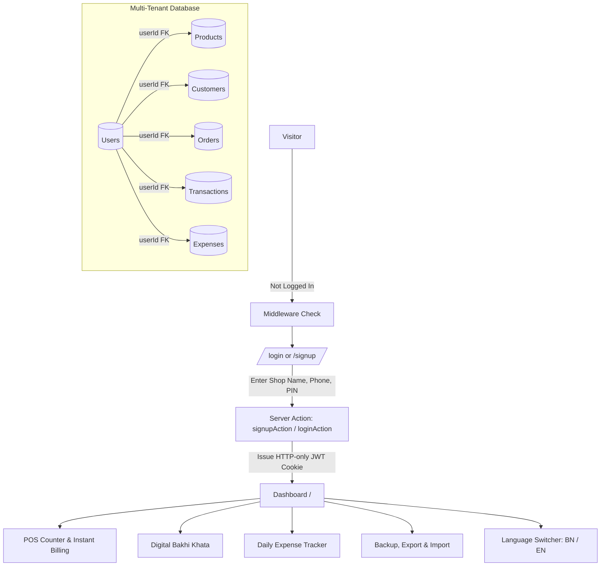

# Implementation Plan: Authentication, Multi-Tenancy, Backup/Import/Export & Bilingual Support

Dokanman currently operates with a pre-seeded single vendor profile. This plan outlines the architecture and execution steps to introduce mandatory user signup/login, complete multi-tenant tenant isolation, backup/import/export capabilities, full bilingual support (বাংলা 🇧🇩 / English 🇬🇧), expense tracking, and product catalog management.

---

## Goal Description

Local Bangladeshi shop and tong vendors using Dokanman must be able to:
1. **Sign Up & Log In**: Secure, mobile-first PIN/password and phone authentication. Once registered, unauthenticated visitors cannot access store transactions or customer debt data.
2. **Multi-Tenant Isolation**: Every vendor has their own isolated catalog of products, customers, transactions, orders, and expenses. New accounts automatically receive standard Tong presets on registration so they can start immediately.
3. **Backup, Export & Import**:
   - One-click full JSON backup of the store's entire database.
   - CSV export for Customers & Due Balances, Transaction Ledger, and Sales.
   - JSON data restore (merge or full restore) and CSV customer list import.
4. **Bilingual Support (বাংলা ও English)**:
   - Full toggle between Bengali (বাংলা) and English across all buttons, forms, labels, tables, and currency/number formatting.
   - Persistent language preference stored in browser and session.
5. **Additional Vital Features for Local Stall Vendors**:
   - **Daily Expense Tracker (দোকানের খরচ)**: Track milk, sugar, tea leaves, gas, and miscellaneous expenses with 1-tap quick buttons to show true Daily Net Profit.
   - **Product Catalog Management**: Add custom snacks/drinks, edit prices (e.g., when cigarette/tea prices change), and toggle quick-access items.
   - **Daily Cash Drawer Closing Slip (আজকের হিসাব স্লিপ)**: Instant printable/copyable daily summary showing cash sales, credit given, credit collected, expenses, and net in drawer.

---

## User Review Required

> [!IMPORTANT]
> **Authentication Method**: We recommend **Mobile Phone Number (11 digits, e.g., 017XXXXXXXX) + 4 to 6 digit Numeric PIN**. Local stall owners rarely remember complex alphanumeric passwords with special characters. A numeric PIN is fast, secure, and familiar from mobile financial services (bKash/Nagad).

> [!NOTE]
> **Starter Presets for New Signups**: When a new user registers their shop (e.g. "আলমগীর টি স্টল"), the system will automatically seed their account with standard Bangladesh Tong items (দুধ চা, রং চা, টোস্ট, কলা, ডিম, সিগারেট, ইত্যাদি) with 0 customers, giving them an instant ready-to-sell counter.

> [!WARNING]
> **Protected Routes**: All core dashboard routes (`/`, `/customers`, `/expenses`, `/settings`) will be protected by Next.js middleware. Users without an active session will be redirected to `/login` or `/signup`.

---

## Open Questions

1. **Auth Credentials**: Do you prefer **Phone + Numeric PIN** (recommended for local tong stall owners), or standard **Phone/Email + Password**?
2. **Existing Seed Data**: Should the existing demo vendor ("মামা টং দোকান") remain as a default demo account (`01700000000` / PIN `1234`) for instant testing?

---

## Proposed Changes



---

### Component 1: Database Schema & Auth Infrastructure

#### [MODIFY] `src/db/schema.ts`
- Add `expenses` table with `userId`, `category`, `amount`, `note`, and `createdAt`.
- Ensure proper foreign keys and relational cascading for all tables under `users`.

```typescript
export const expenses = pgTable("expenses", {
  id: text("id").primaryKey(),
  userId: text("user_id").notNull().references(() => users.id, { onDelete: "cascade" }),
  category: text("category").notNull(),
  amount: decimal("amount", { precision: 10, scale: 2 }).notNull(),
  note: text("note"),
  createdAt: timestamp("created_at").defaultNow().notNull(),
});
```

#### [NEW] `src/lib/auth.ts`
- JWT session management using `jose` with `HS256` encryption.
- Functions:
  - `createSession(user: { id: string; phone: string; shopName: string })`: creates signed, encrypted HTTP-only cookie `dokanman_session`.
  - `getSession()`: retrieves and verifies current session on server components and server actions.
  - `destroySession()`: clears session cookie.

#### [NEW] `src/middleware.ts`
- Intercepts requests to `/`, `/customers`, `/expenses`, `/settings`.
- Redirects unauthenticated requests to `/login`.
- Redirects authenticated requests attempting to visit `/login` or `/signup` back to `/`.

---

### Component 2: Authentication Views & Server Actions

#### [NEW] `src/actions/auth-actions.ts`
- `signupAction({ shopName, phone, pin })`:
  - Validates unique phone and PIN format.
  - Hashes PIN using `bcryptjs`.
  - Inserts new user in `users`.
  - Automatically seeds default quick-access tong products for this new `userId`.
  - Creates session cookie and returns success.
- `loginAction({ phone, pin })`:
  - Fetches user by phone.
  - Compares PIN hash.
  - Establishes session cookie.
- `logoutAction()`:
  - Destroys session and redirects to `/login`.

#### [NEW] `src/app/login/page.tsx`
- Clean mobile-friendly login screen with Dokanman branding.
- Bangladeshi phone number input (`01XXXXXXXXX`) and masked PIN keypad input.
- Link to `/signup`.
- Demo login shortcut for fast evaluation (`01700000000` / `1234`).

#### [NEW] `src/app/signup/page.tsx`
- Quick onboarding: Shop Name ("দোকানের নাম"), Phone Number ("মোবাইল নম্বর"), 4-digit PIN ("পিন কোড").
- Immediate login upon successful registration.

---

### Component 3: Bilingual i18n System (বাংলা 🇧🇩 / English 🇬🇧)

#### [NEW] `src/i18n/translations.ts`
- Complete dictionary of strings mapped across all sections:
  - Common (Buttons, Alerts, Statuses, Confirmations)
  - Navigation & Headers
  - POS Counter & Cart Panel
  - Universal Search & Modals
  - Bakhi Khata & Ledger
  - Expense Tracker
  - Backup & Export
  - Settings & Profile
- Number and currency formatting utilities (`formatCurrency(amount, lang)`: `৳১,২০০` vs `Tk 1,200`).

#### [NEW] `src/context/LanguageContext.tsx`
- Client React Context providing `lang`, `setLang`, and translation lookup function `t(key)`.
- Persists selected language in `localStorage` and a cookie so server components can render matching locale.

---

### Component 4: Backup, Import & Export Engine

#### [NEW] `src/actions/backup-actions.ts`
- `exportFullBackupAction()`:
  - Exports a clean JSON package containing:
    - User shop profile
    - All products
    - All customers
    - All orders and item breakdowns
    - All transaction ledger entries
    - All expense entries
    - Export metadata (schema version, timestamp, total record counts).
- `exportCsvAction(type: 'customers' | 'transactions' | 'orders' | 'expenses')`:
  - Generates RFC-compliant CSV strings with UTF-8 BOM (for Excel Bengali character compatibility).
- `importFullBackupAction(data: BackupPayload, mode: 'merge' | 'replace')`:
  - Validates payload structure and data integrity.
  - In `merge` mode: skips duplicate records by phone/id.
  - In `replace` mode: replaces user data safely within a transaction.
- `importCustomersCsvAction(csvString: string)`:
  - Parses uploaded CSV containing `Name, Phone, Starting Due` and bulk-inserts new customers.

#### [NEW] `src/components/BackupImportExportModal.tsx`
- Visual interface for data safety:
  - One-click Download JSON Backup.
  - Download Customers CSV / Orders CSV / Ledger CSV.
  - Upload & Restore JSON Backup file with validation preview.
  - Upload Customers CSV with auto column mapping.

---

### Component 5: Additional Core Stall Features

#### [NEW] `src/components/ExpenseTracker.tsx` & `src/actions/expense-actions.ts`
- Quick expense logger with 1-tap categories:
  - দুধ (Milk), চা পাতা (Tea Powder), চিনি (Sugar), গ্যাস সিলিন্ডার (LPG Gas), বিস্কুট/কেক পাইকারি (Bakery Wholesale), সিগারেট কার্টন (Cigarette Carton), দোকান ভাড়া/বিদ্যুৎ (Rent/Utility), অন্যান্য (Misc).
- Daily expense totals and list.

#### [NEW] `src/components/DailyClosingModal.tsx`
- **আজকের হিসাব স্লিপ (Daily Summary Report)**:
  - Total Cash Sales
  - Total Credit (বাকি বিক্রি)
  - Cash Collected from Old Debts (বাকি আদায়)
  - Total Expenses (আজকের খরচ)
  - **Net Cash in Hand (ক্যাশ বাক্সে মোট টাকা)**
  - Print button & "WhatsApp-এ হিসাব শেয়ার করুন" (Sends daily closing summary to shop owner's personal phone).

#### [MODIFY] `src/components/Header.tsx` & `src/components/MainApp.tsx`
- Add language toggle button (বাংলা / EN).
- Add user profile dropdown with Shop Name, Phone, and "লগআউট" (Logout).
- Add navigation tabs: **POS কাউন্টার**, **বাকির খাতা**, **দোকানের খরচ**, **হিসাব ও ব্যাকআপ**.

---

## Verification Plan

### Automated Tests
1. **Schema & Migration Verification**:
   ```bash
   NODE_OPTIONS="--no-network-family-autoselection" npm run db:migrate
   ```
2. **TypeScript & Production Build**:
   ```bash
   NODE_OPTIONS="--no-network-family-autoselection" npm run build
   ```

### Manual Verification
1. **Authentication Flow**:
   - Access `/` without logging in -> verify redirect to `/login`.
   - Sign up with a new shop name, phone (`01712345678`), and PIN `4321`.
   - Verify immediate redirect to dashboard with default Tong items pre-populated and 0 customers.
   - Log out -> verify redirect to `/login`.
   - Log back in with the credentials -> verify session restored.
2. **Multi-Tenancy Verification**:
   - Create a customer in Account A -> Log in to Account B -> Verify Account B cannot see Account A's customer or sales.
3. **Backup & Import/Export**:
   - Export JSON backup of shop data -> verify downloaded JSON is complete.
   - Export `customers.csv` -> open and verify Bengali font renders properly with UTF-8 BOM.
   - Test importing a JSON backup or CSV list.
4. **Bilingual Switcher**:
   - Click "EN" -> verify all labels, tables, badges, and modals switch to English.
   - Click "বাংলা" -> verify all strings switch back to Bengali.
5. **Expense Tracker & Daily Cash Closing**:
   - Log an expense of ৳300 for "দুধ (Milk)".
   - Verify Daily Closing slip accurately calculates `Net Cash = Cash Sales + Due Payments - Expenses`.
